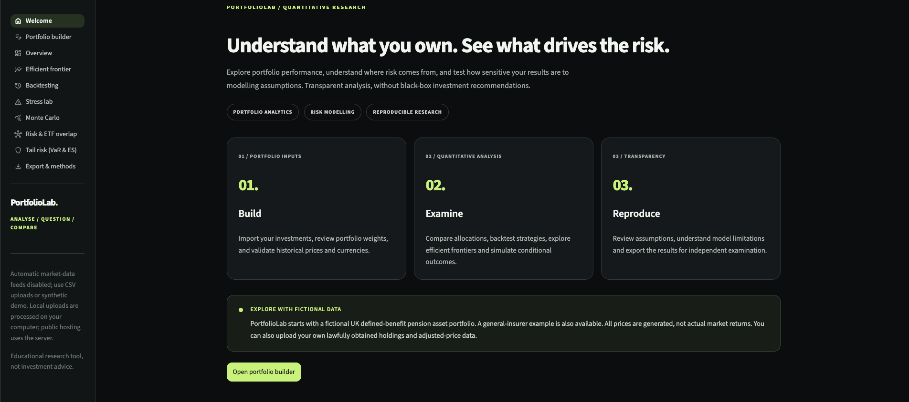
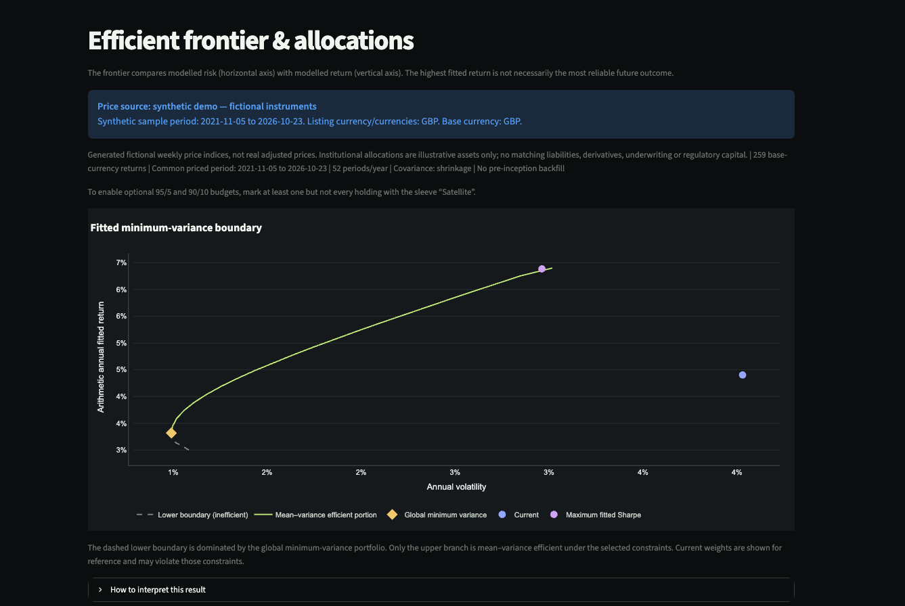
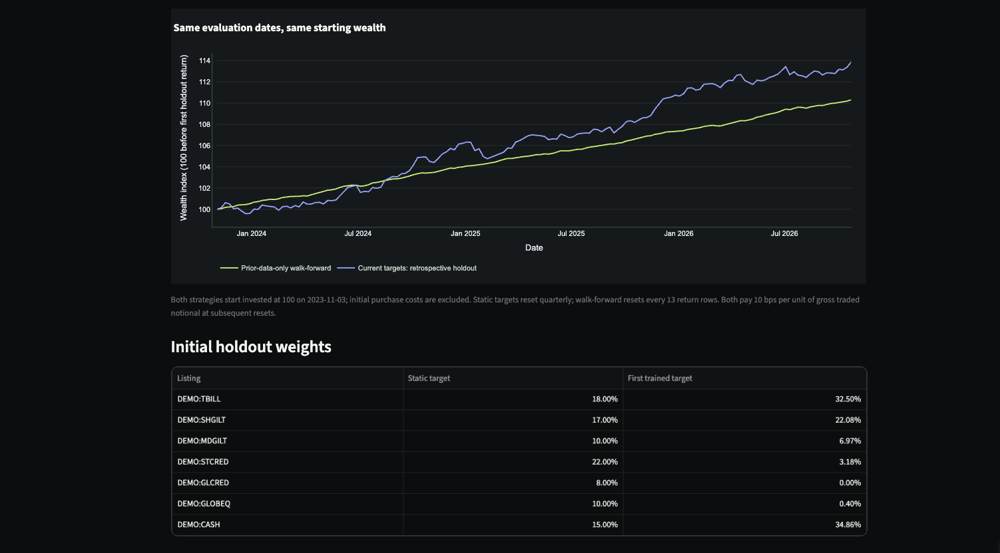
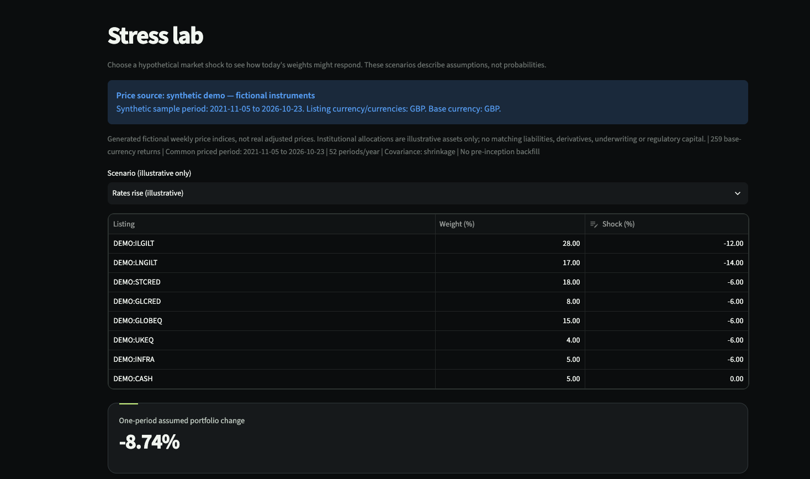
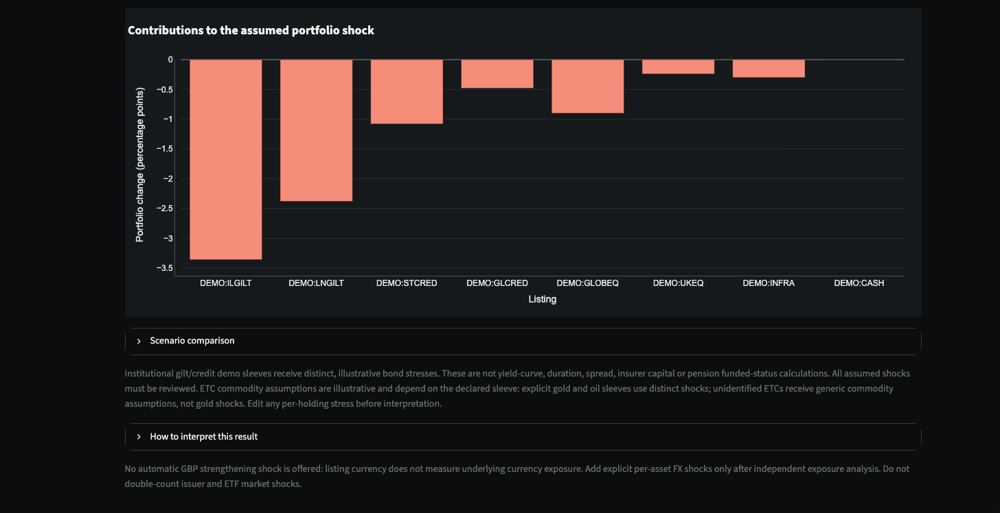
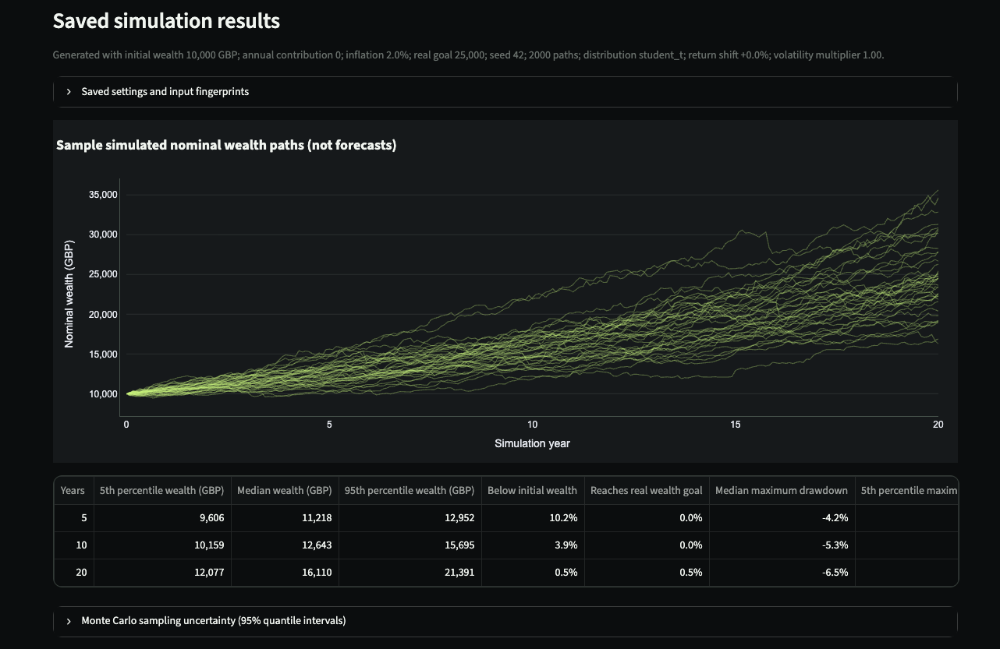
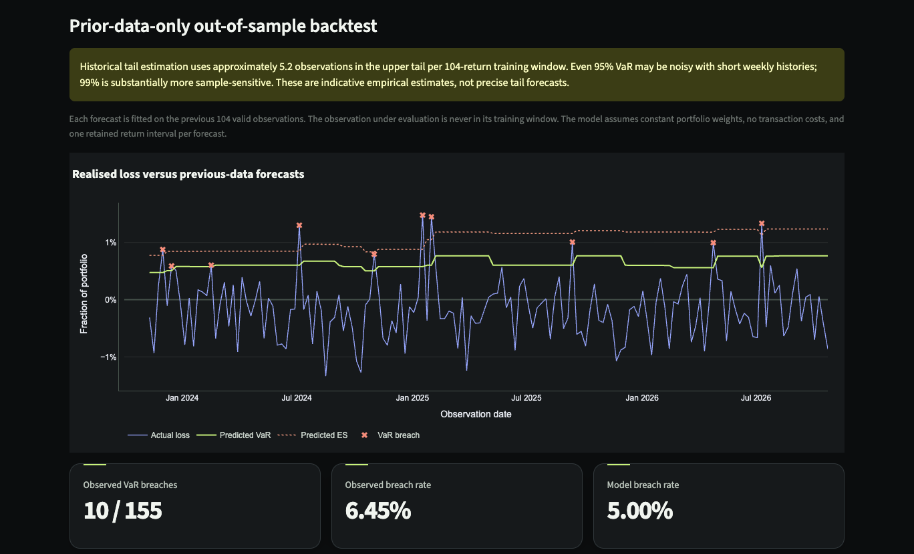

# FolioLab

### Interactive Portfolio Analytics, Quantitative Risk Modelling and Strategy Validation

**FolioLab is an interactive quantitative research application built with Python and Streamlit.** It allows users to explore portfolio performance, optimise allocations, assess downside risk and examine how sensitive their results are to modelling assumptions.

The project takes portfolio optimisation and backtesting beyond a static notebook, combining multiple quantitative methods within a reproducible research workflow.

**[Launch the Live Application](https://foliolab.streamlit.app/)**

**Current version:** v0.3.2 | **Status:** Publicly deployed | **Source code:** Private

---

## Why I Built FolioLab

Portfolio optimisation can produce convincing results, but the outputs are highly dependent on the underlying assumptions.

A portfolio that appears optimal using historical returns and correlations may behave very differently under changing market conditions, alternative risk estimates or different rebalancing rules.

I developed FolioLab to make these assumptions visible and testable.

Rather than presenting an optimal portfolio as a recommendation, FolioLab helps users investigate *why* a particular allocation emerges, *how* it behaves under different scenarios and *where* the modelling limitations lie.

## Application Screenshots

The examples below use fictional institutional portfolios and synthetic market data. All results are illustrative and are not investment forecasts.

### 1. Portfolio Optimisation | Efficient Frontier

**Mean-variance portfolio optimisation.** The chart compares the existing allocation with the global minimum-variance and maximum fitted-Sharpe portfolios. It also distinguishes the mean-variance-efficient frontier from the inefficient lower boundary.

This demonstrates constrained optimisation, covariance estimation and the sensitivity of portfolio selection to fitted historical inputs.

### 2. Strategy Validation | Walk-Forward Backtesting

**Out-of-sample strategy evaluation.** A prior-data-only minimum-volatility strategy is compared with a retrospective static-target portfolio over the same evaluation dates and with the same initial wealth.

The analysis includes rebalancing and simplified transaction-cost assumptions. The comparison illustrates that an optimised strategy does not necessarily outperform a static allocation.

### 3. Scenario Analysis | Interest-Rate Stress

**Illustrative rising-rates scenario.** FolioLab applies explicit asset-level shocks to a fictional UK defined-benefit pension investment portfolio.

The example produces an assumed one-period portfolio change of **-8.74%**. This is a scenario input calculation, not an estimated market loss probability.

**Risk attribution.** Individual holding contributions explain how the aggregate stress result is constructed and which exposures drive the assumed loss.

These scenarios are not full yield-curve repricing, liability valuation or regulatory capital calculations.

### 4. Conditional Monte Carlo | Wealth Simulation

**Stochastic portfolio simulation.** The application generates possible wealth paths under explicitly selected return and covariance assumptions.

This example uses 2,000 paths, a seeded multivariate Student-t innovation model and an initial wealth of GBP 10,000.

The paths demonstrate uncertainty under a statistical model. They are **not forecasts**, and they do not capture every source of market or parameter uncertainty.

### 5. Model Validation | Value at Risk Backtesting

**Rolling Value at Risk and Expected Shortfall diagnostics.** The chart compares realised portfolio losses with forecasts estimated using only prior observations.

For the fictional general insurance portfolio, the illustrated 95% historical VaR backtest records **10 breaches across 155 out-of-sample observations**, equivalent to approximately 6.45%.

The chart identifies individual exceedances and provides information for evaluating risk-model behaviour. Observed breach frequency alone does not establish statistical calibration or predictive reliability.

---

**[Explore the interactive FolioLab application](https://foliolab.streamlit.app/)**

## Key Capabilities

| Module | Features |
|---|---|
| Portfolio Analytics | Performance metrics, annualised volatility, Sharpe ratio, drawdown, diversification and concentration |
| Portfolio Optimisation | Mean-variance efficient frontier, minimum-variance allocation, maximum fitted-Sharpe portfolio and constraints |
| Strategy Backtesting | Buy-and-hold, periodic rebalancing, transaction costs and walk-forward optimisation |
| Stress Testing | Editable market shocks, rising-rate scenarios, equity sell-offs and holding-level stress contributions |
| Monte Carlo Simulation | Conditional long-term wealth distributions using Gaussian and multivariate Student-t models |
| Risk Decomposition | Volatility contributions, correlations and optional ETF issuer-level overlap |
| Tail Risk Analysis | Historical and Gaussian Value at Risk, Expected Shortfall and rolling VaR backtesting |
| Sensitivity Analysis | Evaluate how allocations respond to changes in expected returns, risk assumptions and portfolio constraints |
| Reproducibility | Export inputs, configuration, model results, data provenance and version metadata |

## Quantitative Methodology

FolioLab incorporates several techniques used in quantitative finance and risk management:

**Portfolio optimisation**

- Mean-variance portfolio theory
- Constrained optimisation using SciPy SLSQP
- Sample covariance and Ledoit-Wolf covariance shrinkage
- Efficient frontier and global minimum-variance calculations

**Backtesting and statistical validation**

- Historical portfolio simulation with rebalancing and simplified transaction costs
- Walk-forward estimation using prior observations
- Out-of-sample performance comparisons
- VaR exceedance and coverage diagnostics, including Kupiec and Christoffersen tests

**Risk modelling and simulation**

- Historical and parametric VaR and Expected Shortfall
- Gaussian and multivariate Student-t Monte Carlo innovations
- Illustrative market stress scenarios
- Portfolio volatility decomposition and sensitivity analysis

The application exposes important assumptions and explicitly warns when certain calculations are unsupported or based on insufficient information.

## Institutional Research Demonstrations

FolioLab includes two fictional, asset-only institutional portfolio examples:

**UK Defined-Benefit Pension Portfolio**

An illustrative allocation with nominal gilts, index-linked gilts, investment-grade credit, equities, infrastructure and cash.

**General Insurance Investment Portfolio**

An illustrative allocation emphasising fixed-income exposures, liquidity and a smaller equity allocation.

These portfolios use synthetic market data and shared risk factors. They are intended to demonstrate the analytical workflow, not to represent actual institutional portfolios.

The application does not model pension liabilities, funding ratios, insurance claims, regulatory capital requirements or complete asset-liability management.

## Software Engineering and Verification

The project was developed with an emphasis on numerical reliability, reproducibility and transparent limitations.

Verification performed for the v0.3.2 release included:

- **150 passing non-browser Python tests**
- **7 passing local Chromium browser tests**
- Passing GitHub Actions checks on **Python 3.11 and 3.12**
- Independent synthetic numerical checks for selected risk calculations and edge cases
- Manual acceptance testing of the publicly deployed application
- Reproducible ZIP exports containing inputs, settings and calculated results

Specific safeguards address incomplete price histories, unsupported optimisation results, potentially misleading stress assumptions and insufficient tail-risk data.

These tests verify particular software and mathematical behaviours. They do not demonstrate predictive investment performance or constitute an independent security or model certification.

## Try FolioLab

**[Open FolioLab](https://foliolab.streamlit.app/)**

1. Open the application in your browser.
2. Select one of the fictional demonstration portfolios or upload your own appropriately sourced data.
3. Run the analysis.
4. Explore optimisation, backtesting, stress testing, simulations and tail risk.
5. Adjust assumptions and export reproducible results.

No brokerage connection or account registration is required.

**Data privacy:** Uploaded portfolio files are processed by the Streamlit hosting server. Avoid submitting confidential financial information without independently assessing the hosting and data-handling arrangements.

## Technology

**Language:** Python

**Application framework:** Streamlit

**Scientific computing:** NumPy, pandas, SciPy, scikit-learn

**Visualisation:** Plotly

**Testing and CI:** pytest, Playwright/Chromium, GitHub Actions

## Limitations

FolioLab is an educational and research application, not an investment advice or trading service.

Key limitations include:

- Historical relationships may not persist in future markets.
- In-sample portfolio optimisation is not a forecast of future performance.
- Monte Carlo outcomes are conditional on estimated parameters and selected distributions.
- Stress scenarios are illustrative assumptions rather than calibrated event probabilities.
- Backtesting does not eliminate all selection, survivorship or modelling biases.
- Simplified transaction-cost and execution assumptions limit real-world applicability.
- Institutional examples do not include liability or regulatory capital modelling.

## Project Availability

This repository serves as the **public project showcase**. The quantitative engine and full application source remain in a separate private development repository.

The live application is available for interactive exploration:

**https://foliolab.streamlit.app/**

## Contact

For feedback or security concerns:

**portfoliolab.streamlit@gmail.com**

Please do not email passwords, confidential holdings or sensitive financial information.

---

*Developed by [Aws Khalid](https://github.com/awskhalid33) as an independent quantitative finance and portfolio risk research project.*
